# Collection flow: acquisition → lock → per-slice measurement → bearing

**Scope.** What happens between the GCS pressing "start collection" and
receiving a bearing, as implemented in `detector/pulse_detector.py`,
`detector/collection_control.py`, `controller/CommandHandler.cpp`,
`controller/CollectionCoordinator.cpp` and `controller/BearingCalculator.cpp`.
The per-cycle signal processing inside one dwell is in
[DETECTOR_PIPELINE.md](DETECTOR_PIPELINE.md); the HIGH/LOW confidence
classification is in [CONFIDENCE_PIPELINE.md](CONFIDENCE_PIPELINE.md).

## Actors and channels

```
GCS (TagTracker)
   │  MAVLink tunnel: START_COLLECTION, START_COLLECTION_SLICE, FINISH_COLLECTION
   │                  ← pulse reports, COLLECTION_STATUS, BEARING_RESULT
   ▼
MavlinkTagController2
   │  TTDP over UDP (shared/detector_protocol.h):
   │     → ARM(heading_deg)          ← READY, ARMED, SLICE_PROGRESS (≤ 1 Hz while armed), SLICE_CAPTURED,
   │                                    COMPUTE_PROGRESS (each stage change, else ≤ 1 Hz, while analysing),
   │                                    PULSE, NO_DETECTION, CYCLE_COMPLETE, FAILED, HEARTBEAT (1 Hz)
   ▼
pulse_detector.py  (one process per tag, alive for the whole collection)
```

A *collection* is one rotation: the GCS flies N headings (slices), and the
controller ARMs every detector once per slice. Slices are identified by
`(collection_id, slice_id)`; both are echoed in every detector message.

## State machine (one collection)

The GCS drives the rotation one heading at a time; the controller gates each
heading on every detector; the detectors keep state across headings. A heading
is complete for the GCS once every detector has *captured* its segment: each
detector analyses a captured slice on its main thread while its capture thread
records the next heading, so the aircraft does not hover through the analysis
(~23–36 s per slice on the flight computer, #173). Only the last announced
slice — `slice_id ≥ n_slices`, which includes a revisit — is held until every
analysis has finished, so `FINISH_COLLECTION` always sees the full set of
results.

```mermaid
stateDiagram-v2
    [*] --> Starting : GCS START_COLLECTION(antenna_id, n_slices)
    Starting --> Ready : every detector READY (30 s timeout, else COLLECTION_STATUS_FAILED)

    state "Per heading (detector capture thread)" as Heading {
        [*] --> Yawing : GCS yaws aircraft to heading N (clockwise sweep, 45° steps at 8 slices)
        Yawing --> Arming : GCS START_COLLECTION_SLICE(slice N, heading_deg)
        Arming --> Dwelling : controller sends ARM(heading) to every detector, all reply ARMED
        Dwelling --> [*] : K·PRI of IQ accumulated (about 40 s at K=20, tip 2 s); detector sends SLICE_PROGRESS once a second on IQ arrival, then SLICE_CAPTURED, and queues the segment for analysis

        note right of Arming
            Detector on ARM: cursor = stream head (no IQ discarded),
            opens detector_<tag>.jsonl under heading-NNN/
            (heading-NNN-sSS/ if this heading was already flown).
            ARM while capturing → BUSY. Re-ARM of a captured slice →
            SLICE_CAPTURED again (and CYCLE_COMPLETE once analysed).
        end note
    }

    Ready --> Heading : next heading
    Heading --> Ready : SLICE_CAPTURED from every detector → COLLECTION_STATUS_SLICE_COMPLETE; the slice is analysed while the next heading is flown
    Heading --> AwaitingAnalysis : last announced slice captured
    AwaitingAnalysis --> Ready : CYCLE_COMPLETE for every captured slice from every detector → COLLECTION_STATUS_SLICE_COMPLETE
    Ready --> Finishing : GCS FINISH_COLLECTION (NACKed while any analysis is pending)
    Finishing --> Heading : winner sighted on one heading only → COLLECTION_STATUS_REVISIT_REQUESTED(revisit_heading_deg), at most once
    Finishing --> [*] : weighted pattern fit of every candidate, w = (median noise_psd / noise_psd)². BEARING_RESULT per tag, NaN if below confidenceFloor, confirmed = sighted on ≥ 2 headings. GCS shows confirmed / unconfirmed / nothing heard + sector. Detectors torn down
    Ready --> [*] : GCS cancel → COLLECTION_STATUS_STOPPED
```



Each captured slice then runs the same analysis on the detector's main thread,
in capture order, regardless of lock state — what changes after the first
qualifying candidate is *what gets reported* (see
[Lock candidates](#lock-candidates)):

```mermaid
stateDiagram-v2
    [*] --> Blanking : captured segment taken from the queue (at most 4 waiting; a backlog is logged)
    Blanking --> Folding : optional impulse blanking (--impulse-blank-factor), then STFT
    Folding --> Thresholding : full-K fold search over the acquisition band
    Thresholding --> Reporting : permutation null of this dwell's own windows gives the threshold at pf, re-derived without a detected train's windows. Up to 4 frequency-separated peaks
    state Reporting {
        [*] --> Acq : bank empty
        [*] --> Locked : bank holds a candidate
        Acq --> [*] : send PULSE (status 0/1) or NO_DETECTION (3), first qualifying peak becomes candidate 0
        Locked --> [*] : fold sidebands, bank new candidates, then one final result per pending (slice, candidate) pair: CONFIRMED (2) or NO_DETECTION (3)
    }
    Reporting --> [*] : CYCLE_COMPLETE

    note right of Locked
        Qualifying peak: score_ratio ≥ 3.0, no dominant fold, within ±2 kHz,
        not a sideband of a ≥ 20 dB stronger peak with the same pulse windows.
        Same emitter as a banked candidate (±200 Hz, PRI either configured rate) → sighting.
        New and bank < 4 → admitted; every earlier heading re-searched at its frequency.
        New and bank full → dropped. Below 3.0 → not reported after lock.
    end note
    note right of Thresholding
        No cache: threshold is per dwell, per heading.
        cycle_threshold record: mu, sigma, n_perm, refined, blanked_fraction, null_ms.
    end note
```



Throughout the analysis the detector sends `COMPUTE_PROGRESS` from the compute
loop itself — at each stage change (spectrogram, search, null, measurement)
and otherwise at most once a second, from inside the permutation loop and the
measurement loop (including each re-search's own null) — so a computation
that hangs goes quiet. Its records are appended to the analysed slice's own
`heading-NNN/detector_<tag>.jsonl`, not the heading being captured.

An ARM while a slice is being captured is answered `BUSY`; a repeated ARM for
the last captured slice re-sends `SLICE_CAPTURED`, and `CYCLE_COMPLETE` too if
its analysis has finished (`collection_control.py`). Since either one gates the
GCS and the GCS only re-ARMs after a lost ACK, the detector also sends each of
them a second time 1 s later; the controller treats the copy as a duplicate.
If both copies of a `SLICE_CAPTURED` are lost, the detector's first
`COMPUTE_PROGRESS` for the active slice stands in for it, within about a second.
If both copies of a `CYCLE_COMPLETE` are lost, the detector's next
`CYCLE_COMPLETE` retires it: a detector analyses its slices in order, so a
completed slice implies every earlier one. Only the last slice's completion has
no later one to stand in for it; losing both copies stalls the rotation.
Nothing on the control plane clears IQ: an ARM only records the stream index
at which the slice begins (`iq_stream.py`), so a slice starts at the first
sample after the aircraft has settled on the heading.

### Rotation progress

The whole collection is reported to the GCS as one `OPERATION_PROGRESS`
operation with `command = START_COLLECTION` (`controller/RotationProgress.cpp`
driving the shared `OperationProgressReporter`, so it also holds the busy gate
for the rotation's duration). Steps advance only on evidence of work: one per
pipeline process started, one per detector `READY`, then per slice one for
`ARMED`, one per second of dwell (from `SLICE_PROGRESS`, governed by the
detector credited with the least work — seconds received plus seconds its own
restarts discarded — so a short-segment detector that has finished does not
hold the step, and a restart on one detector cannot move it while another has
received nothing), and one when the slice is captured; then one analysis wait
of at least `kAnalysisEstimateSteps` = 30 steps for the last slice, ticked at
1 Hz from the heartbeat while the GCS is held on it; and finally three
finalize stages (stopping detectors, computing bearing, sending results). A
wait that runs past its estimate grows the layout.

Every analysis in flight must keep reporting: if a detector with a queued or
running analysis has sent no `COMPUTE_PROGRESS` for more than
`kComputeProgressTimeoutSeconds` = 5 heartbeat ticks, or its current slice's
analysis has run for more than `kMaxAnalysisSeconds` = 120 ticks (normally
23–36 s), the step is frozen — during the next heading's dwell too — so the
GCS stall watchdog (10 s) cancels a hung or runaway analysis within about
15 s. The message carries the stage of the analysis in flight, e.g.
`3/8 090 deg | 045 deg: null 24/40` during a dwell or
`Analysing 315 deg: measure 1/3` while the GCS waits.

`step_count` is sized at `START_COLLECTION`
from `n_slices` and a `(K+1)·PRI` dwell estimate, then corrected from
`SLICE_PROGRESS` (the longest segment reported by any detector) and grown by one slice
(and another analysis wait) on
`REVISIT_REQUESTED`. When a detector restarts its segment after an IQ gap
(`samples_have` drops by more than 2 s), the discarded seconds are added to the
current slice as extra steps, so the step keeps advancing on resumed input
instead of holding until the detector regains its old count. The step never
moves backwards within one layout. The
operation ends `COMPLETE` after `COLLECTION_STATUS_STOPPED` on finalize and
`FAILED` on cancel, detector `FAILED`, detector process exit or startup timeout.
Because `SLICE_PROGRESS` is only sent when IQ arrives, a stalled stream stops
the step, which is the signal the GCS uses to cancel a hung rotation instead of
per-phase timeouts.

## Per-slice cycle

Every slice, locked or not, runs the same full-K fold search
(`fold_detect`), so a tag that only becomes visible late in the rotation is
still found. Constants:

| Symbol | Value | Meaning |
| --- | --- | --- |
| `--k` | per tag, from the GCS (`tagInfo.k`; TagTracker default 20) | Folds per cycle; one cycle ≈ K × PRI |
| `USABLE_BAND_FRACTION` | 0.9 | Fold search never enters the decimator's transition band: bins beyond 0.9 × fs/2 (±1728 Hz) are masked out |
| `ACQUISITION_SEARCH_HZ` | 2000 | Fold search is further masked to ±2 kHz around the entered tag offset (`args.freq − center_freq`) |
| `--detection-margin` | 1.0 | Multiplies the per-dwell permutation-null threshold (DETECTOR_PIPELINE.md §6); 1.0 = the threshold is `pf` |
| `--null-permutations` | 40 | Window permutations per cycle for the null |
| `--confidence-ratio` | 1.3 | `score_ratio` at or above → HIGH (`detection_status` 1), else LOW (0); subject to the dominant-fold gate below |
| `DOMINANT_FOLD_THRESHOLD` | 0.8 | `max_fold_fraction` above, with fewer than half the folds (or fewer than two) over 3× the bin noise → a transient: LOW, and ineligible for lock. A train with one much stronger pulse (a collar being handled) is not a transient |
| `max_detections` | every separated peak during a collection, else 1 | Extra peaks feed the candidate bank only, after sideband folding, so sidebands never take a bank slot; the acquisition report is always the single strongest |

The slice's power spectrogram is appended to `buffered_slices` (a deque of
`MAX_BUFFERED_SLICES` = 64; the oldest is evicted with a warning) together
with its noise estimate, segment start time, heading, its full-search
sightings (`{candidate id: Detection}`) and a `measured` set of candidate ids
whose result has been reported.

### Reports in acquisition (no lock yet)

| Outcome | Message | `detection_status` | `confirmed_status` | `candidate_id` |
| --- | --- | --- | --- | --- |
| Strongest peak, `score_ratio ≥ 1.3`, no dominant fold | `PULSE` | 1 SUPERTHRESHOLD | 1 | 0 |
| Strongest peak otherwise | `PULSE` | 0 SUBTHRESHOLD | 0 | 0 |
| Nothing above threshold | `NO_DETECTION` | 3 | 0 | 0 |

followed by `CYCLE_COMPLETE` once the slice's analysis is done.

## Lock candidates

**What "lock" does and does not mean.** Nothing is committed to until
`FinishCollection`: every heading still runs the full-K fold search, up to four
qualifying emitters from anywhere in the rotation are banked, each gets a
result on every heading, and the controller fits all of them and picks the
best. The "provisional lock" is simply the first qualifying peak (candidate
0). What it *does* change, from that heading onward, is the report stream:
acquisition reports (status 0/1) stop, and only per-candidate results (status
2 or 3) are sent (`pulse_detector.py`, "Post-lock fold results only feed the
candidate bank; they are not reported as acquisition hits").

**A candidate is a frequency, not a pulse train.** A dual-rate collar on a
moving animal can switch rate any number of times, inside a dwell or unseen
between dwells, and each switch restarts its train. Timing seen on one heading
therefore says nothing about another heading; only the carrier frequency
carries across. No timing is ever projected from one heading onto another,
and a heading's result, once reported, is final (2026-10-13 rotation 1: a
re-anchor after a rate switch inside the 045° dwell overwrote heading 0's
68.5 dB with noise).

After the fold search, the dwell's peaks are first split into emitters and
**sidebands** (`fold_sidebands`): a peak is a sideband when at least half its
fold windows lie within `SIDEBAND_TIMING_WINDOWS` = 2 steps of a peak whose
per-pulse power is at least `SIDEBAND_MIN_DB` = 20 dB higher. A strong collar
shows such components 30–35 dB down at about ±975 Hz with exactly its pulse
timing; they are logged (`LOCK_CANDIDATE` `sideband`) and never banked. Every
emitter peak that satisfies all of

- `score_ratio ≥ --lock-score-ratio` (default **3.0**),
- no dominant fold (`fold_info['dominant_fold']`),
- `|freq − expected_offset| ≤ ACQUISITION_SEARCH_HZ`

is offered to the candidate bank (`admit_lock_candidate`), strongest first.
It is the *same emitter* as a banked candidate (`same_emitter`) when its
frequency is within `LOCKED_SEARCH_HZ` = 200 Hz and its PRI is either
configured rate (within one STFT step). Phase plays no part.

| Peak | Event |
| --- | --- |
| Same emitter as a banked candidate | `seen`: sighting recorded (`{slice_id: score_ratio}`); the candidate's frequency follows the latest sighting |
| New, bank < `MAX_LOCK_CANDIDATES` = 4 | `admitted` (appended) |
| New, bank full | `dropped` — a `LOCK_CANDIDATE dropped` `.jsonl` entry only |

**The first cycle that has any qualifying candidate locks immediately**: the
strongest becomes candidate 0. There is no same-heading confirmation cycle.
Ids are reported to the controller, so entries are never renumbered or
evicted — the bank is append-only. Sightings are kept in lockstep with the
bank.

On a later heading a peak at `1.0 ≤ score_ratio < 3.0` that is not a banked
candidate (it would have been a status 0/1 report before lock) is **not
reported**; it stays in the `.jsonl` `DETECTION`/`FOLDS` entries for
post-flight analysis. So if the provisional lock is a false peak, a real tag
that only reaches `score_ratio` 1.3–2.9 is never banked and is invisible live;
the rotation ends with a rejected or low-`r_squared` bearing. Raising
`score_ratio ≥ 3.0` at K=20 makes a false provisional lock unlikely (none of
the 69 Apr-11 noise detections exceeded 2.55) but the asymmetry is by design.

## Locked cycles

Once the bank holds a candidate, each cycle does, in order:

1. **Fold search at full K** (as above) — sidebands folded, new candidates
   appended, existing ones get sightings.
2. **One result per pending (slice, candidate) pair**
   (`RotationCandidates.pending`, `measure_candidate`): this slice for every
   candidate, and every buffered slice for a candidate admitted this cycle.
   Each result uses that slice's data only:
   - **Sighted** — the full search found the candidate on this slice: the
     train is measured at that sighting's own fold windows and rate.
   - **Not sighted** — a **frequency-only re-search**: the fold search and its
     permutation null are re-run on the candidate's nearest bin and
     `RESEARCH_BIN_RADIUS` = 1 bin either side only, within the usable band. Fewer cells searched
     means a lower threshold at the same `pf` (≈ 2.1 dB less signal above the
     noise score at K = 20, dual rate, 2026-10-13 geometry). A train found
     there without a dominant fold is measured the same way.
   - **Neither** — a non-detection, which the bearing fit treats as censored.

   The measurement (`measure_at_pulse_windows`) sums power at the found bin
   over a two-window footprint per pulse, the footprint start common to all
   pulses chosen from the fold window or one before it (local-max pooling),
   subtracts noise and divides by the number of pulses kept
   (`per_pulse_power_psd`). Pulses touching a zero-filled window are dropped;
   if that leaves none, the slice gets no result for the candidate (logged as
   `lock_candidate` event `unmeasurable`) rather than a non-detection.
   A re-search hit is chosen by a max-search, so it reads high on weak
   headings: ≈ +0.6 dB at 50 % detection probability, ≈ +1.3 dB at 17 %, a
   few percent once detection is near certain (simulated, K = 20).

### Locked report

One message per (slice, candidate):

| Field | Found (sighted or re-search) | Not found |
| --- | --- | --- |
| message / `detection_status` | `PULSE`, 2 CONFIRMED | `NO_DETECTION`, 3 |
| `confirmed_status` | 1 | 0 |
| `candidate_id` | 0 = provisional lock, 1–3 = alternates | same |
| `frequency_hz` | the bin it was found at | the candidate's frequency |
| `group_snr` | `per_pulse_power_psd` — the amplitude the fit uses | 0 |
| `snr` | `lock_snr_db` (diagnostic) | 0 |
| `score_ratio` | full-search fold score ratio when sighted; **0 for a re-search hit** (it is not an independent sighting for `confirmed` or the revisit) | 0 |
| `noise_psd` | slice noise at the bin | slice noise at the candidate's bin |
| `collection_id`, `slice_id` | of the *buffered* slice — results for earlier headings carry the earlier slice id | same |
| `rate_state` | the dwell's own winning hypothesis (A, B, A→B, B→A) | A |

A late candidate therefore gets a result on every earlier heading in one cycle
("retro" in the text log; `heading_deg` in the `.jsonl` record names the
heading, so the analyzer can re-file it). The `.jsonl` record carries
`sighted` and `research_ratio` (the re-search's best score ratio, found or
not). A failed send leaves the pair pending and it is retried next cycle;
nothing is ever re-sent once delivered, so per-cycle work no longer grows with
the number of headings.

## Controller side

### Storage and forwarding (`CommandHandler::_handlePythonPulse`)

- Every report during a collection is upserted into `_rotationSlices` keyed by
  `(tag_id, candidate_id, slice_id)`. A detection replaces a no-detection; a
  CONFIRMED measurement replaces an acquisition hit; a no-detection replaces
  an acquisition report (status 0/1/3), since it can only be candidate 0's
  verdict on that slice: the acquisition hit was at another frequency, or the
  acquisition no-detection's noise is the band median rather than the
  candidate's bin. A no-detection
  never replaces a CONFIRMED result. No-detections are censored observations
  for **their own candidate's** fit only.
- **Outside a collection** every report (0/1/3) is forwarded to the GCS.
- **During a collection** only the tag's **live candidate** (`_liveCandidate`,
  initially 0) is forwarded: its CONFIRMED (2) reports
  (`CollectionCoordinator::forwardPulseToGcs`), and its no-detections (3)
  once stored as that heading's result. TagTracker shows a CONFIRMED value per
  tag and heading; a no-detection removes that tag's value from the heading
  (a value left by an earlier live candidate, or an acquisition hit).
- After each CONFIRMED report `_updateLiveCandidate` refits every candidate
  (`BearingCalculator::solveCandidates`). Another candidate takes over the live
  view when it has ≥ `kLiveCandidateMinSlices` = 3 measured slices and its
  `r_squared` exceeds the live one's by more than
  `kLiveCandidateSwitchMargin` = 0.15; the controller then replays all of that
  candidate's CONFIRMED and no-detection reports so the GCS display corrects
  mid-rotation, including headings where the new candidate was not found.

### Handshake and timing (`CollectionCoordinator`)

`START_COLLECTION` (carries `antenna_id`, selects the pattern table, and
`n_slices`, NACKed when 0) → controller waits up to 30 s for `READY` from every detector, else
cancels with `COLLECTION_STATUS_FAILED`. Per slice: `START_COLLECTION_SLICE` →
controller sends `ARM(heading)` to every detector → each replies `ARMED`,
captures its segment and sends `SLICE_CAPTURED` → when the last detector has
captured, the controller sends `COLLECTION_STATUS_SLICE_COMPLETE` to the GCS.
Each detector's analysis of that slice is tracked separately until its
`CYCLE_COMPLETE` (a `CYCLE_COMPLETE` for the active slice also counts as its
capture, in case `SLICE_CAPTURED` was lost). For the last announced slice
(`slice_id ≥ n_slices`) `SLICE_COMPLETE` waits until no analysis is pending
at all. There is **no controller timeout on a slice**; the coordinator stays
in `CollectingSlice` until every detector reports, and a stalled detector is
the GCS's to time out (see [Rotation progress](#rotation-progress)). A repeated
`START_COLLECTION_SLICE` for a completed slice replays `SLICE_COMPLETE` without
re-arming. Pulse reports are accepted for any armed slice of the current
collection, between slices too, since they trail capture by one heading.

`FAILED` from a detector is forwarded as `COLLECTION_STATUS_FAILED` with the
detector's error code only if it names the slice being captured or a slice
still being analysed; otherwise it is logged and ignored. The controller does
not tear the collection down on its own — the GCS decides whether to cancel.

### `FINISH_COLLECTION`

1. **Revisit check** (before tearing detectors down, since locks and buffers
   live in them): `BearingCalculator::revisitHeadingFor(solve())` — if the
   winning candidate was *sighted* (independent fold detection, `score_ratio >
   0`) on only one heading, the controller replies
   `COLLECTION_STATUS_REVISIT_REQUESTED` with `revisit_heading_deg` at the
   fitted bearing and keeps the collection open. The GCS flies that heading as
   one more slice and finishes again. At most one revisit per collection
   (`_revisitRequested`); a FINISH retry before the slice is armed gets the
   same request again.
2. **Fit** every candidate of every tag (`solveCandidates`): weighted least
   squares of `power(θ) = A·pattern(θ − φ) + B` in **linear power**
   (`signal_psd`) against the antenna table (`AntennaPatterns::byId`, 19 points
   0–180° at 10°, linearly interpolated, folded about 180°). Each detected
   heading is weighted by the inverse variance of its measurement, which for a
   K-pulse noise-subtracted mean scales as `1 / noise_psd_i²`; weights are
   expressed relative to the median heading, `w_i = (median noise_psd /
   noise_psd_i)²`, so a heading with an invalid `noise_psd` gets weight 1 and K
   (taken as common to all slices) cancels; a gap-clipped slice that averaged
   fewer pulses is over-weighted by `K/n` (#153). Headings near the floor
   therefore inform the fit without dominating it. A candidate's
   no-detection headings are censored: the model must predict less than half
   its weakest detected power there. `r_squared` is a composite confidence
   (weighted fit × angular span × degrees-of-freedom factors). Per-heading
   residuals are kept on the result for diagnostics.
3. **Select** per tag the candidate with the highest `r_squared`. A
   candidate that clears `confidenceFloor` always beats one that does not,
   so the tie-break below can never trade a valid bearing for a rejection.
   Otherwise, candidates
   within `kCandidateConfidenceTolerance` = 0.05 of each other are not
   separated by the fit (two candidates measuring the same pulses — a
   duplicate lock, a sideband the detector did not fold — differ by well under 0.01 from noise
   alone, a flat interferer against a pattern-shaped tag by tenths); among
   those the one with more *sighted* slices wins, then more detected slices,
   then higher `best_snr`. The selected candidate is `rejected` if
   `r_squared < confidenceFloor` (0.2
   for both RA-2A and RA-23K).
4. **Report** `BEARING_RESULT` per tag. Three outcomes share the existing
   fields:
   - *Bearing*: finite `bearing_deg`, `r_squared`, `n_valid_slices`,
     `best_snr`, `confirmed = n_sighted_slices ≥ kConfirmedSightings (2)`.
   - *Heard, no bearing*: `bearing_deg` NaN, `r_squared` 0, `n_valid_slices`
     > 0. Either the selected lock fell below the confidence floor, or the
     tag **never locked** and its acquisition hits (`score_ratio` 1–3,
     `detection_status` 0/1) agree in frequency: at least
     `kHeardMinAgreeingHits` = 2 within `kHeardFrequencyToleranceHz` = 200 Hz
     of one another. Acquisition hits alone never produce a bearing: each is
     inside the per-heading false-alarm rate and three of them near threshold
     do not constrain the pattern fit (2026-09-12 `below-marginal` run: 117°
     for a tag at 135°). Two in one bin on different headings is ~1e-3 per
     rotation from noise, so agreement in frequency is what separates "heard"
     from "nothing".
   - *Nothing heard*: `bearing_deg` NaN, `n_valid_slices` 0, `best_snr` 0 —
     no detections, or scattered acquisition hits that do not agree.
   If the selected candidate is not the one the GCS was following live, its
   CONFIRMED and no-detection slice reports are replayed first.
5. **Log** `bearing_result.log`
   (`tag_id,bearing_deg,r_squared,n_valid_slices,best_snr,latitude,longitude,n_sighted_slices,confirmed,heard`)
   and `bearing_candidates.log`
   (`tag_id,candidate_id,bearing_deg,confidence,n_valid_slices,best_snr,selected,rejected,n_sighted_slices,residuals`;
   `residuals` is `;`-separated `heading:residual:weight` per detected heading,
   residual = `measured − fitted` power)
   in the rotation directory.
6. **Replay on retry.** The candidate replays, `BEARING_RESULT`s and the final
   `COLLECTION_STATUS_STOPPED` have no ACK of their own, so every frame the
   finalize pushed is kept (`_lastFinishOutcome`, keyed by `collection_id`;
   a `REVISIT_REQUESTED` answer is kept the same way). A
   `FINISH_COLLECTION` for an already-finished id (`CollectionCoordinator`
   `Duplicate`) re-sends those frames before ACKing; a byte-identical retry
   (same `request_id`) replays them through a replay-only path before its
   cached ACK, so a late retry can never finalize or cancel anything. A
   cached-success `START_COLLECTION_SLICE` retry likewise re-runs the slice
   handler, whose `Duplicate` / `AlreadyComplete` paths re-send `SLICE_ARMED`
   / `SLICE_COMPLETE`.
   On the GCS,
   `PythonWaitForFinishOutcomeState` re-enters the FINISH send state (new
   `request_id`) when neither outcome arrives within 5 s, up to 2 times, and
   only then aborts the rotation.

On the GCS the finite/NaN bearing, `n_valid_slices` and `confirmed` flag
become one of four operator-facing states — *confirmed*, *unconfirmed* (lock
seen on one heading only), *heard, no bearing* (NaN with `n_valid_slices` > 0),
*nothing heard* (NaN with `n_valid_slices` = 0) — plus the 45° rose sector the
bearing falls in; the sector is derived from `bearing_deg` and the flown slice
count, nothing extra is carried on the wire.

## Simulator levels

`--simulator <level>` with a configured tag drives this flow end to end
(levels and SNRs: [simulator/README.md](../../simulator/README.md#controller-signal-levels)).
The SNRs were chosen around the detector's `--lock-score-ratio` of 3.0 at
K=20; the per-dwell permutation-null threshold
([DETECTOR_PIPELINE.md](DETECTOR_PIPELINE.md)) moves the exact `score_ratio`
each level produces, so the outcomes below are the intent to verify, not a
guarantee. The transmitter sits at 135°; with TagTracker's clockwise sweep
from 0° that is the fourth heading, so the first three headings are always
re-searched at the candidate's frequency once a lock exists.

- **`strong`** (20 dB): locks on the first heading that sees the tag (0° is
  45° off-axis, still tens of dB up); sighted on every heading → *confirmed*,
  sector 3, bearing ≈ 135°. The tag is 50–70 dB over noise, so its spectral
  sidebands clear the threshold too; they are folded into it
  (`LOCK_CANDIDATE` `sideband`), not banked (#148).
- **`moderate`** (−8 dB): sighted on every heading (deepest pattern null
  still ≈ 20 dB over noise) → *confirmed*, bearing ≈ 135°, one candidate, no
  sidebands.
- **`marginal`** (−27 dB): sighted on one heading only (135°, `score_ratio`
  ≈ 5 against the lock ratio 3; ±45° ≈ 2, below it). The frequency-only
  re-search may still find the ±45° headings, which then enter the fit but
  are not sightings. `FINISH_COLLECTION`
  returns `COLLECTION_STATUS_REVISIT_REQUESTED`, the GCS flies that heading
  again, then *confirmed* if the revisit sights it, otherwise *unconfirmed*.
  −21 dB gave three sightings and a confirm without a revisit.
- **`below-marginal`** (−33 dB): never locks (best `score_ratio` ≈ 1.6 at
  135°) but the tag's bin clears the `pf` threshold on the two or three
  headings nearest 135°. No bearing is fitted from such hits; because they
  agree in frequency the result is *heard, no bearing* (`bearing_deg` NaN,
  `n_valid_slices` > 0).
- **`silent`**: `noise-only` preset. No lock, `mu` ≈ 68 on every heading
  (`refined: true` on some — the strongest noise bin passing the train gate —
  without moving `threshold`), at most a few scattered `pf` hits (≈ 0.4 per
  rotation) → *nothing heard* (`bearing_deg` NaN, `n_valid_slices` 0). Two
  noise hits in one bin would wrongly read as *heard*; ~1e-3 per rotation.
- **`competing`** (−18 dB tag, flat −18 dB tone at +1 kHz): the interferer
  takes the provisional lock (candidate 0) on the first heading; the tag is
  admitted as an alternate near 135°; every buffered heading gets a result
  for both; the finish-time fit must select the tag (pattern-shaped) over the
  interferer (flat).
- **`power-line`** (−8 dB tag, directional Gaussian source +15 dB at
  boresight, bearing 270°, seen through the antenna pattern): the source adds
  to the base noise, so the combined floor is ≈ 15 dB up at 270°, ≈ 10 dB up
  at 225°/315° (45° off the source is −5.65 dB on the RA-2A table), ≈ 9 dB at
  90° (back lobe) and near the base floor where the pattern nulls it
  (`cycle_threshold.mu` and `threshold` stay ≈ 68–75 throughout; the noise
  PSD column in `analysis.md` shows the swing), with no false detections. The
  bearing fit down-weights the noisy headings (`bearing_candidates.log`
  weights ≪ 1 at 225–315°) and the result stays *confirmed* at ≈ 135°.
  `--sim-noise-source-impulsive` makes the source heavy-tailed (Student-t) to
  exercise `--detector-impulse-blank-factor`.

With a dual-rate tag, `--sim-rate-switch <s>` (optionally with
`--sim-rate-burst <s>`) switches the simulated collar to its secondary rate
that many seconds into the rotation (and back after the burst), so a rotation
contains a rate switch at a chosen heading. Every heading must still report
its own power; the carrier stays one candidate.

## Log artifacts per collection

```
~/Logs/Logs-Rotation-<UTC>/
  MavlinkTagController.log, airspyhf_decimator.log, airspyhf_zeromq_rx.log
  bearing_result.log, bearing_candidates.log
  heading-000/detector_<tag>.jsonl        ← LOCK_CANDIDATE, DETECTION, CANDIDATE_MEASUREMENT,
  heading-045/…                             NO_DETECTION, FOLDS, TIMING entries for that slice
  heading-090-s09/…                       ← a revisit that landed on an already-flown heading
  analysis.md                             ← analyzer/post_flight_analysis.py, run at session stop
```

The `SESSION_END` entry (process-wide totals) is written to whichever heading
file is open when the detector exits.

## Related

- [DETECTOR_PIPELINE.md](DETECTOR_PIPELINE.md) — the per-cycle STFT / fold / threshold processing
- [CONFIDENCE_PIPELINE.md](CONFIDENCE_PIPELINE.md) — HIGH/LOW classification
- [shared/README.md](../../shared/README.md#ttdp-detector-protocol) — TTDP message layout
- [2026-09_DETECTOR_AMPLITUDE_ANALYSIS.md](../analysis/2026-09_DETECTOR_AMPLITUDE_ANALYSIS.md) — why the fixed-offset amplitude and retrospective lock were introduced; the cross-heading projection it describes was removed after the 2026-10-13 field test (a dual-rate collar restarts its train at every rate switch)
- `detector/tests/test_rotation_candidates.py`, `test_end_to_end.py`, `test_collection_control.py`, `controller/tests/test_collection_coordinator.cpp`, `test_bearing_calculator.cpp`
